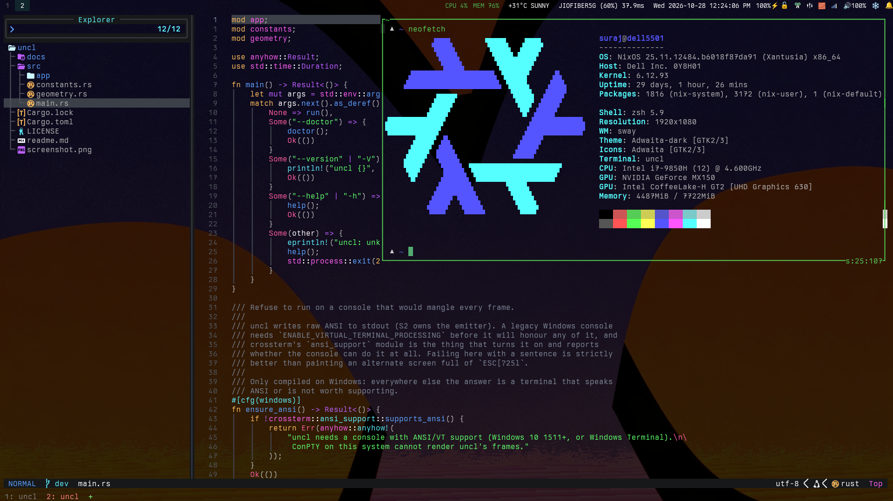

# uncl 0.1a

    

> [!WARNING]
> Early alpha release, expect glitches and bugs.

## inspiration

terminal multiplexers are overkill. tmux involves a learning curve most could do without and zellij is ... an acquired taste lets just say. what if there was something for the terminal monotaskers among us, something simpler than existing solutions that makes that extra terminal tab unncessary, something that minimises context-switch cognitive load and looks cool while doing it.

## introduction

uncl is a terminal monoplexer - a single, toggleable, resizeable, and draggable floating term window as an accomplice to your worst terminal misdeeds, written in rust.



## features

- toggle a floating terminal with a single `[Home]` key
- floating term is draggable and resizeable with mouse
- floating term is draggable and resizeable with keyboard
- supports most shells, tested on zsh, bash
- supports most terminal emulators, tested on wezterm
- images inside the float: kitty graphics and iTerm2 inline images are carried
  through (`chafa --format=kitty`, `wezterm imgcat`, `timg -pk`, ...)
- clickable links inside the float (`OSC 8`): `ls --hyperlink=always`, `gh`,
  `gcc -fdiagnostics-urls` and friends work; children see `FORCE_HYPERLINK=1`.
  a plain click opens one, in the float or in the shell behind it - `http`,
  `https`, `mailto`, `file` and `ftp` only, and only when the program that printed
  it is not using the mouse itself
- scrollback in both panes - the float and the shell behind it - sized by
  `UNCL_SCROLLBACK` from the environment you launch uncl in
- the float's border shows the child's window title (`OSC 0/2`), so a float
  running `nvim` or `ssh` says what it is; its size and scroll offset sit in the
  bottom border
- copy and paste (`OSC 52`): copies are relayed to your real clipboard, and a
  paste request reads it back - from what a child copied in this session, or from
  the desktop through `wl-paste`/`xclip`/`xsel`/`pbpaste`/`Get-Clipboard`
- children get your terminal's `TERM` (alacritty, foot, wezterm, xterm...), and
  `xterm-256color` where uncl cannot carry what that `TERM` implies: `screen`/
  `tmux` dialects, and kitty's keyboard protocol. `uncl --doctor` prints both

### images: what is, and is not, supported

uncl does not decode, scale or re-encode anything. The child's bytes are carried
through to your terminal and re-emitted inside the float, so what you get is
whatever your terminal can do:

- kitty graphics and iTerm2 inline images work out of the box.
- sixel is opt-in (`UNCL_SIXEL=1`) and only on a terminal that can draw it.
- an image too big for the float is scaled down to fit it (by your terminal - the
  bytes are passed through untouched), keeping its aspect ratio. Small images are
  never scaled up. uncl measures your cell size from the tty at startup and
  reports it to children; `UNCL_CELL_PX=WxH` overrides the measurement and
  `uncl --doctor` prints it.
- sixel images larger than the float are skipped, once, with a note on stderr:
  sixel has no way to ask for a size, and uncl never re-encodes.
- no animation, no alpha, no scaling, no re-encoding.
- the background shell's images are not carried through - only the float's.

### scrollback

both panes keep history, and the size is inherited from the environment uncl was
launched in:

- `UNCL_SCROLLBACK=10000 uncl` keeps 10,000 lines per pane (the default is 2,000).
  `UNCL_SCROLLBACK=0` turns history off. Anything that is not plain digits is
  ignored in favour of the default - uncl does not guess at memory.
- the wheel scrolls the pane under the pointer. while the float is scrolled back
  its border shows how far (`s:24:80 +12`), and `Ctrl+Alt+Up/Down` scrolls a notch
  and `Ctrl+Alt+PageUp/PageDown` a screenful for terminals without a wheel.
- typing anything puts the view back on the live screen; the keystroke still goes
  to the shell, exactly as in every other terminal.
- uncl holds the mouse while it runs - that is how the float stays draggable, and
  how a click on a link gets resolved at all - so your terminal emulator's own
  scrollback is not available inside uncl. uncl's is. `Shift`+drag still selects
  text in most emulators, because they take that key back locally.

## installing

prebuilt archives are attached to the releases: `uncl-linux-x86_64.tar.gz`,
`uncl-windows-x86_64.zip`, `uncl-macos-aarch64.tar.gz` and
`uncl-macos-x86_64.tar.gz`. each holds the binary, `readme.md` and `LICENSE`.
unpack it and put `uncl` somewhere on your `PATH`.

- linux: built on ubuntu 22.04, so it wants glibc 2.35 or newer.
- macos: neither signed nor notarised - the first run needs
  `xattr -d com.apple.quarantine uncl`, or right-click -> open in finder.
- windows: windows 10 1809 or newer, for a console that speaks ansi.

or build it, with a rust toolchain (edition 2024, so rust 1.85 or newer):

```sh
git clone https://github.com/inversepolarity/uncl && cd uncl
cargo install --path .
```

## releases

`dev` is where work lands and `main` is the switch. a push to `dev` that changes
`src/`, `Cargo.toml` or `Cargo.lock` runs the tests, bumps the patch version,
builds every platform, and replaces the **draft** release - nothing is visible
yet. a push to `main` publishes that draft, which is the moment the tag appears.
a `dev` push that only touches docs or the readme does nothing.
