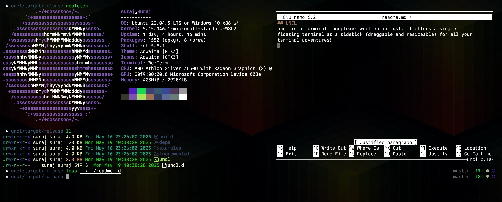

# uncl

> [!WARNING]
> Early alpha release, expect glitches and bugs.

## inspiration

terminal multiplexers are overkill. tmux involves a learning curve most could do without and zellij is ... an acquired taste lets just say. what if there was something for the terminal monotasker among us, something simpler than existing solutions that makes that extra terminal tab unncessary, minimizing context-switch cognitive load and looks cool while doing it.

## introduction

uncl is a terminal monoplexer - a single, toggleable, resizeable, and draggable floating term window as an accomplice to your worst terminal misdeeds, written in rust.

## features

- toggle a floating terminal with a single `[Home]` key
- floating term is draggable and resizeable with mouse
- floating term is draggable and resizeable with keyboard
- supports most shells, tested on zsh, bash
- supports most terminal emulators, tested on wezterm
- images inside the float: kitty graphics and iTerm2 inline images are carried
  through (`chafa --format=kitty`, `wezterm imgcat`, `timg -pk`, ...)

### images: what is, and is not, supported

uncl does not decode, scale or re-encode anything. The child's bytes are carried
through to your terminal and re-emitted inside the float, so what you get is
whatever your terminal can do:

- kitty graphics and iTerm2 inline images work out of the box.
- sixel is opt-in (`UNCL_SIXEL=1`) and only on a terminal that can draw it.
- an image wider than the float is not cropped: it is drawn from its cell and
  your terminal clips it at the screen edge, so it may overlap the border. (uncl
  measures your cell size from the tty at startup and reports it to children;
  `UNCL_CELL_PX=WxH` overrides the measurement, `uncl --doctor` prints it.)
- sixel images larger than the float are skipped, once, with a note on stderr.
- no animation, no alpha, no scaling, no re-encoding.
- the background shell's images are not carried through - only the float's.
